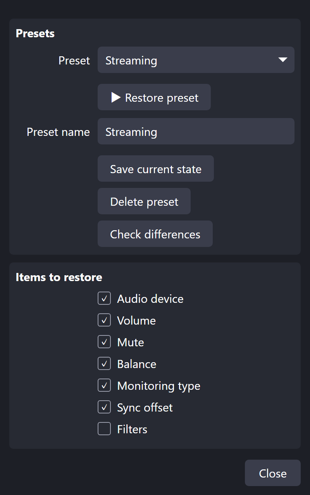
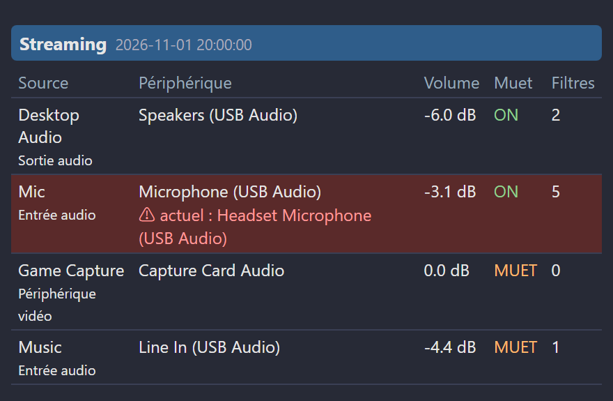

[English](README.md) | [日本語](README.ja.md) | [한국어](README.ko.md) | [Bahasa Indonesia](README.id.md) | **Français** | [繁體中文](README.zh-TW.md)

# Audio Device Restorer for OBS

Quand OBS change un périphérique audio sans prévenir, restaurez votre configuration en **un clic ou avec un raccourci** : volume, sourdine et, en option, les filtres avec les réglages des plugins VST. Le plugin VST lui-même n'est pas sauvegardé.

> Testé sur : OBS Studio 32.2.2, Windows 11. Langues : EN / JP / KR / ID / FR / TW
> Version 1.7.0 ・ Auteur : ChromeBread feat. BlackDream ・ Licence : GPL-2.0

## Préréglages et éléments à restaurer

Choisissez ce qui est restauré : périphérique, volume, sourdine, balance, monitoring, décalage de synchro et filtres. Tout est coché par défaut sauf les filtres.

## Utilisation
1. Placez tout le dossier `Audio_Device_Restorer_for_OBS` dans `%APPDATA%\obs-studio\plugin_config\` (collez ce chemin dans la barre d'adresse de l'Explorateur pour l'ouvrir).
2. Dans OBS, ouvrez **Outils → Scripts → +** et sélectionnez `audio_device_restorer.lua`.
3. Réglez vos sources. Choisissez des **périphériques précis** plutôt que « Par défaut ».
4. Saisissez un nom de préréglage et cliquez sur **Enregistrer l'état actuel**.
5. Quand un périphérique change, cliquez sur **Restaurer le préréglage**.

Le raccourci se règle dans **Paramètres → Raccourcis**.

## Autres fonctions
- Plusieurs préréglages, vérification des différences
- Restauration automatique lors d'un changement et au démarrage d'OBS (désactivée par défaut)
- 9 emplacements de sauvegarde automatique pour annuler une erreur
- Enregistrement protégé des coupures de courant, avec reprise automatique depuis `.bak`
- Export / import des réglages de filtres, transfert des préréglages vers un autre PC

## Voir dans un dock OBS

Le dock affiche le contenu des préréglages et signale en rouge les périphériques différents.

Les emplacements de fichiers, comme l'URL du dock, sont masqués pour ne pas apparaître en direct. Activez le **mode débogage** pour les afficher.

## Désinstallation
Retirez le script dans **Outils → Scripts** (sélection, puis **−**), fermez OBS, puis lancez `Safe_Uninstaller.bat`. Il indique le rôle de chaque fichier, vous laisse choisir quoi supprimer, sauvegarde vos réglages, explique le passage à un autre PC et envoie le tout à la Corbeille.

Le détail complet est disponible en [English](README.md).

Ce script tiers n'est pas officiel. Il n'est ni affilié au projet OBS ni approuvé par celui-ci.

## Mises à jour

Ce logiciel ne vérifie pas les mises à jour et ne se met pas à jour tout seul, et aucune fonction de mise à jour automatique connectée à Internet n'est prévue. Pour mettre à jour, suivez le lien du développeur et téléchargez vous-même la nouvelle version sur le site de distribution : [Releases](../../releases)
