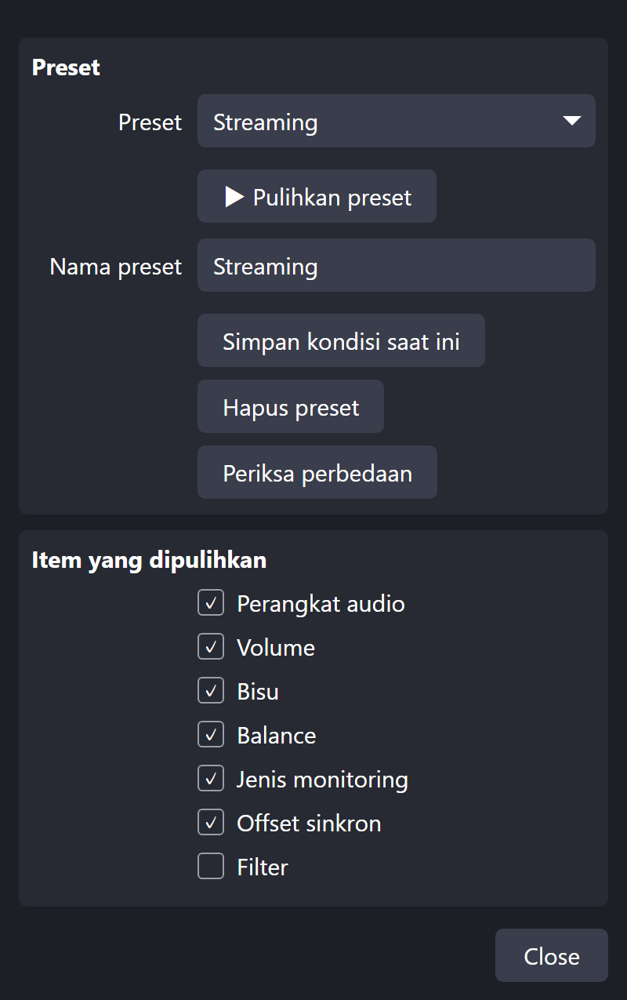
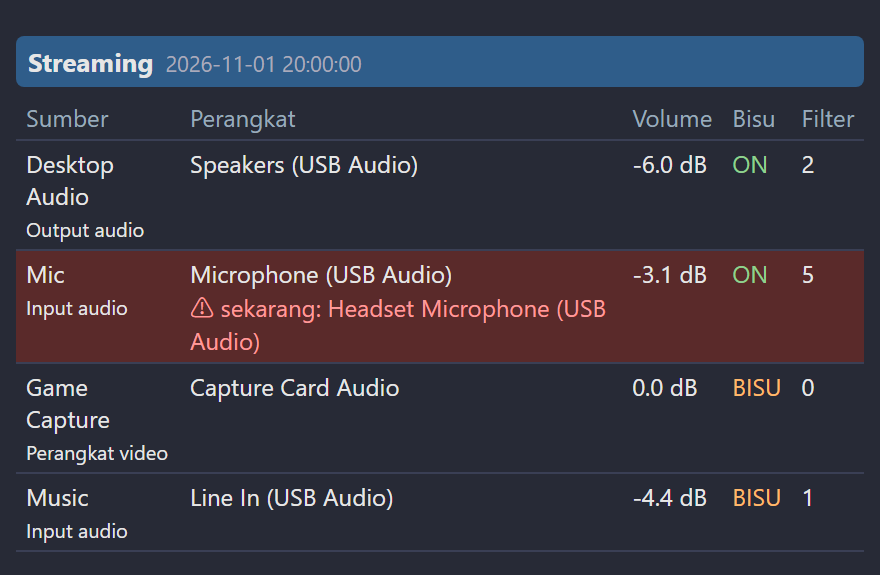

[English](README.md) | [日本語](README.ja.md) | [한국어](README.ko.md) | **Bahasa Indonesia** | [Français](README.fr.md) | [繁體中文](README.zh-TW.md)

# Audio Device Restorer for OBS

Saat OBS mengganti perangkat audio secara diam-diam, pulihkan pengaturan tersimpan dengan **satu klik atau hotkey**, termasuk volume, mute, dan (opsional) pengaturan filter serta pengaturan plugin VST. Plugin VST itu sendiri tidak dicadangkan.

> Diuji pada: OBS Studio 32.2.2, Windows 11. Bahasa: EN / JP / KR / ID / FR / TW
> Version 1.6.0 ・ Pembuat: ChromeBread feat. BlackDream ・ Lisensi: GPL-2.0

## Preset dan item yang dipulihkan

Pilih apa yang dipulihkan: perangkat, volume, mute, balance, monitoring, sync offset, dan filter. Semua aktif secara default kecuali filter.

## Cara pakai
1. Di OBS buka **Alat → Skrip → +** dan pilih `audio_device_restorer.lua`.
2. Atur sumber sesuai keinginan. Pilih **perangkat tertentu**, bukan "Default".
3. Masukkan nama preset lalu tekan **Simpan kondisi saat ini**.
4. Saat perangkat berubah, tekan **Pulihkan preset**.

Hotkey dapat diatur di **Pengaturan → Hotkey**.

## Fitur lain
- Banyak preset, periksa perbedaan
- Pemulihan otomatis saat berubah dan saat OBS dimulai (default mati)
- 9 slot simpan otomatis untuk membatalkan kesalahan
- Penyimpanan yang aman dari mati listrik, dengan pemulihan otomatis dari `.bak`
- Ekspor / impor pengaturan filter, pindah preset ke PC lain

## Lihat di dock OBS

Dock menampilkan isi preset dan menandai perangkat yang berbeda dengan warna merah.

Centang **Mode Debug** untuk menampilkan lokasi file seperti URL Dock. Layar konfirmasi muncul agar tidak terlihat saat siaran, dan mode ini mati setiap kali pengaturan dibuka.

## Hapus instalasi
Hapus skrip dari **Alat → Skrip** (pilih, tekan **−**), tutup OBS, lalu jalankan `Safe_Uninstaller.bat`. Alat ini menampilkan fungsi tiap file, memungkinkan Anda memilih yang dihapus, mencadangkan pengaturan, menjelaskan cara pindah ke PC lain, dan memindahkan semuanya ke Recycle Bin.

Penjelasan lengkap tersedia di [English](README.md).

Ini adalah skrip pihak ketiga tidak resmi. Tidak berafiliasi dengan atau didukung oleh OBS Project.
