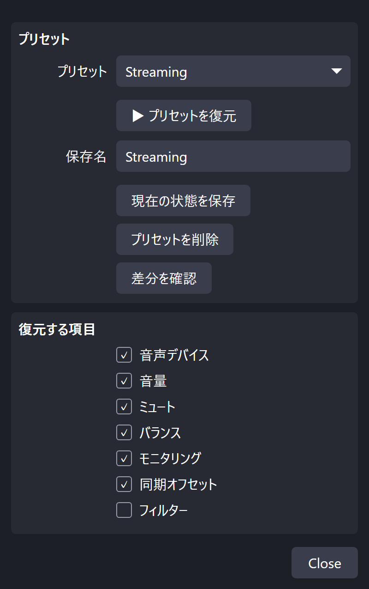
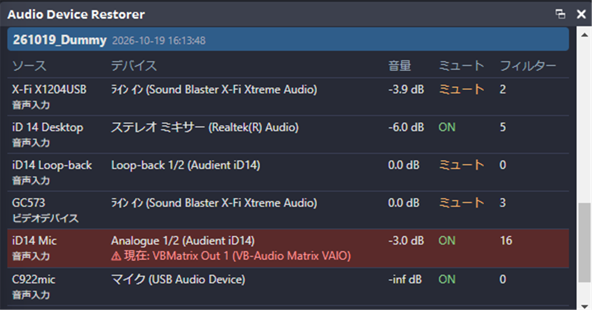

[English](README.md) | **日本語** | [한국어](README.ko.md) | [Bahasa Indonesia](README.id.md) | [Français](README.fr.md) | [繁體中文](README.zh-TW.md)

# Audio Device Restorer for OBS

OBS が音声デバイスを勝手に切り替えたとき、保存した設定を **ワンクリックまたはホットキー** で元に戻します。音量、ミュート、必要に応じてフィルターの設定 (VST プラグインの設定を含む) も復元できます。VST プラグイン本体はバックアップしません。

> 動作確認: OBS Studio 32.2.2、Windows 11。言語: EN / JP / KR / ID / FR / TW
> Version 1.5.0 ・ 製作者: ChromeBread feat. BlackDream ・ ライセンス: GPL-2.0

## プリセットと復元する項目

デバイス、音量、ミュート、バランス、モニタリング、同期オフセット、フィルターから、復元する項目を選べます。フィルター以外は初期状態でオンです。

## 使い方
1. OBS の **ツール → スクリプト → +** で `audio_device_restorer.lua` を選びます。
2. ソースを希望の状態にします。「既定」ではなく **特定のデバイス** を選んでください。
3. **プリセット** に名前を入れて **現在の状態を保存** を押します。
4. デバイスが変わったら **プリセットを復元** を押します。

ホットキーは **設定 → ホットキー** の「音声デバイスを復元」で設定できます。

## その他の機能
- 複数のプリセット、差分の確認
- 変更時と OBS 起動時の自動復元 (初期状態はオフ)
- 誤操作を戻せる 9 個のオートセーブスロット
- 保存処理は停電で壊れない方式で、`.bak` から自動で復帰します
- フィルター設定の書き出し / 読み込み、別の PC へのプリセット移行

## OBS ドックで確認する

プリセットの内容を一覧表示し、保存時と異なるデバイスは赤く表示します。

**デバッグモード** にチェックを入れると、ドックURLなどファイルの場所が表示されます。配信中に映らないよう、確認画面が出ます。設定を開くたびにオフへ戻ります。

## アンインストール
**ツール → スクリプト** でスクリプトを外し (選択して **−**)、OBS を閉じてから `Safe_Uninstaller.bat` を実行します。各ファイルの内容を表示し、削除するものを選べます。設定のバックアップ、別の PC への引っ越し手順の表示にも対応し、削除したものはごみ箱へ移動します。

詳しい説明は [English](README.md) をご覧ください。

これは非公式のサードパーティ製スクリプトです。OBS Project とは関係がなく、承認も受けていません。
