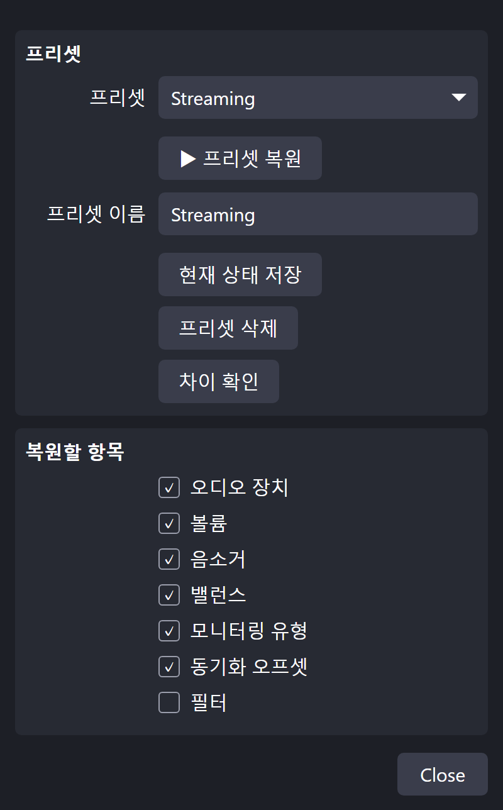
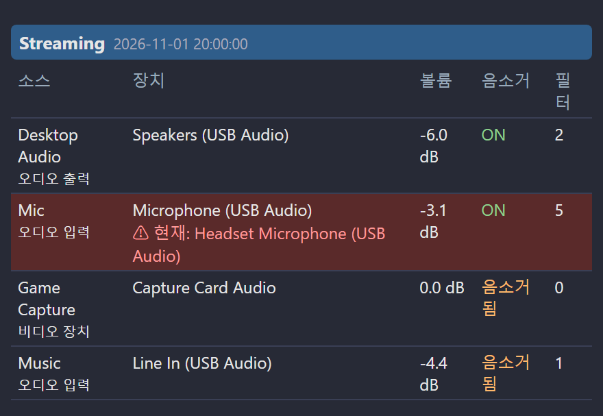

[English](README.md) | [日本語](README.ja.md) | **한국어** | [Bahasa Indonesia](README.id.md) | [Français](README.fr.md) | [繁體中文](README.zh-TW.md)

# Audio Device Restorer for OBS

OBS가 오디오 장치를 임의로 바꿨을 때 저장한 설정을 **원클릭 또는 단축키**로 되돌립니다. 볼륨, 음소거, 필요하면 필터 설정 (VST 플러그인 설정 포함)도 복원합니다. VST 플러그인 본체는 백업하지 않습니다.

> 테스트 환경: OBS Studio 32.2.2, Windows 11. 언어: EN / JP / KR / ID / FR / TW
> Version 1.6.0 ・ 제작자: ChromeBread feat. BlackDream ・ 라이선스: GPL-2.0

## 프리셋과 복원할 항목

장치, 볼륨, 음소거, 밸런스, 모니터링, 동기화 오프셋, 필터 중 복원할 항목을 고를 수 있습니다. 필터를 제외하고 기본으로 켜져 있습니다.

## 사용 방법
1. OBS의 **도구 → 스크립트 → +** 에서 `audio_device_restorer.lua`를 선택합니다.
2. 소스를 원하는 상태로 설정합니다. "기본값"이 아닌 **특정 장치**를 선택하세요.
3. 프리셋 이름을 입력하고 **현재 상태 저장**을 누릅니다.
4. 장치가 바뀌면 **프리셋 복원**을 누릅니다.

단축키는 **설정 → 단축키**에서 지정할 수 있습니다.

## 기타 기능
- 여러 프리셋, 차이 확인
- 변경 시와 OBS 시작 시 자동 복원 (기본 꺼짐)
- 실수를 되돌리는 9개의 자동 저장 슬롯
- 정전에도 손상되지 않는 저장 방식과 `.bak` 자동 복구
- 필터 설정 내보내기 / 가져오기, 다른 PC로 프리셋 이동

## OBS 도크에서 확인

프리셋 내용을 목록으로 보여 주고, 저장 시와 다른 장치는 빨갛게 표시합니다.

**디버그 모드**를 체크하면 도크 URL 등 파일 위치가 표시됩니다. 방송에 노출되지 않도록 확인 화면이 나오며, 설정을 열 때마다 꺼집니다.

## 제거
**도구 → 스크립트**에서 스크립트를 뺀 뒤 (선택하고 **−**) OBS를 닫고 `Safe_Uninstaller.bat`을 실행합니다. 각 파일의 내용을 보여 주고 제거할 항목을 고를 수 있습니다. 설정 백업과 다른 PC로 옮기는 방법도 제공하며, 제거한 항목은 휴지통으로 이동합니다.

자세한 내용은 [English](README.md)를 참고하세요.

비공식 서드파티 스크립트입니다. OBS Project와 관련이 없으며 승인을 받지 않았습니다.

## 업데이트 안내

이 소프트웨어에는 업데이트 확인이나 자동 업데이트 기능이 없으며, 앞으로도 인터넷에 연결하는 자동 업데이트 기능을 구현할 계획이 없습니다. 업데이트할 때는 개발자의 링크를 따라 배포 사이트에서 직접 내려받으세요: [Releases](../../releases)
