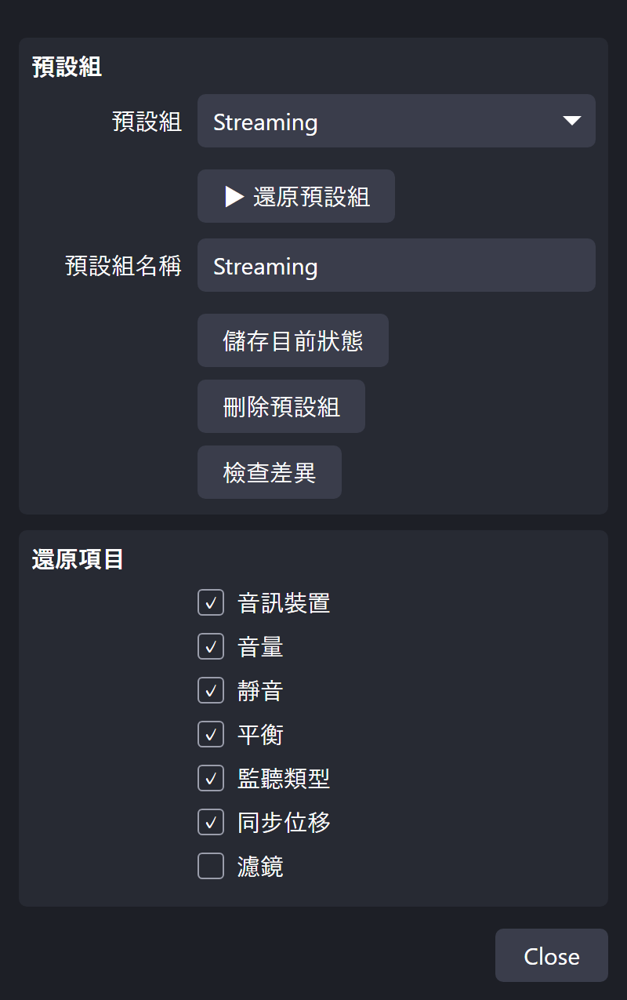
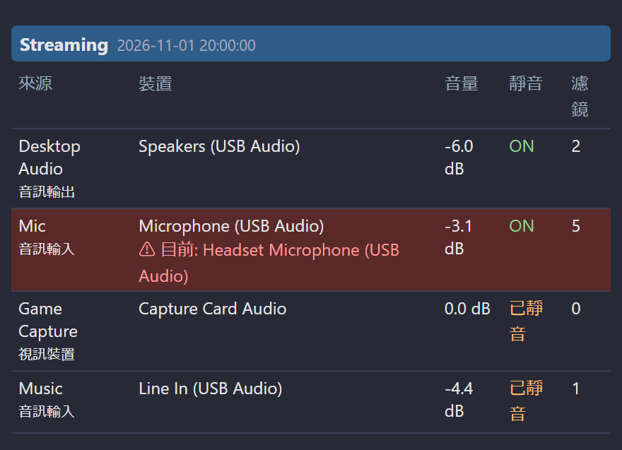

[English](README.md) | [日本語](README.ja.md) | [한국어](README.ko.md) | [Bahasa Indonesia](README.id.md) | [Français](README.fr.md) | **繁體中文**

# Audio Device Restorer for OBS

當 OBS 自行切換音訊裝置時，可用 **一鍵或快速鍵** 還原已儲存的設定，包含音量、靜音，以及可選的濾鏡設定 (含 VST 外掛設定)。VST 外掛本身不會備份。

> 測試環境: OBS Studio 32.2.2、Windows 11。語言: EN / JP / KR / ID / FR / TW
> Version 1.5.0 ・ 製作者: ChromeBread feat. BlackDream ・ 授權: GPL-2.0

## 預設組與還原項目

可選擇要還原的項目：裝置、音量、靜音、平衡、監聽、同步偏移與濾鏡。除濾鏡外預設皆開啟。

## 使用方式
1. 在 OBS 開啟 **工具 → 腳本 → +**，選擇 `audio_device_restorer.lua`。
2. 將來源設為想要的狀態。請選擇 **特定裝置**，不要用「預設」。
3. 輸入預設組名稱並按 **儲存目前狀態**。
4. 裝置變更時，按 **還原預設組**。

快速鍵可在 **設定 → 快速鍵** 設定。

## 其他功能
- 多個預設組、檢查差異
- 變更時與 OBS 啟動時自動還原 (預設關閉)
- 9 個自動儲存欄位，可復原誤操作
- 不怕斷電的儲存方式，可從 `.bak` 自動復原
- 濾鏡設定匯出 / 匯入、將預設組搬移到其他電腦

## 在 OBS 停駐視窗查看

停駐視窗會列出預設組內容，並以紅色標示與儲存時不同的裝置。

勾選 **偵錯模式** 會顯示 Dock 網址等檔案位置。為避免在直播中露出，會先出現確認畫面，且每次開啟設定時都會關閉。

## 解除安裝
在 **工具 → 腳本** 移除腳本 (選取後按 **−**)，關閉 OBS，再執行 `Safe_Uninstaller.bat`。它會顯示每個檔案的用途，可選擇要移除的項目、備份設定、說明如何搬移到其他電腦，並將項目移到資源回收筒。

完整說明請見 [English](README.md)。

這是非官方的第三方腳本，與 OBS Project 無關，也未獲其認可。
